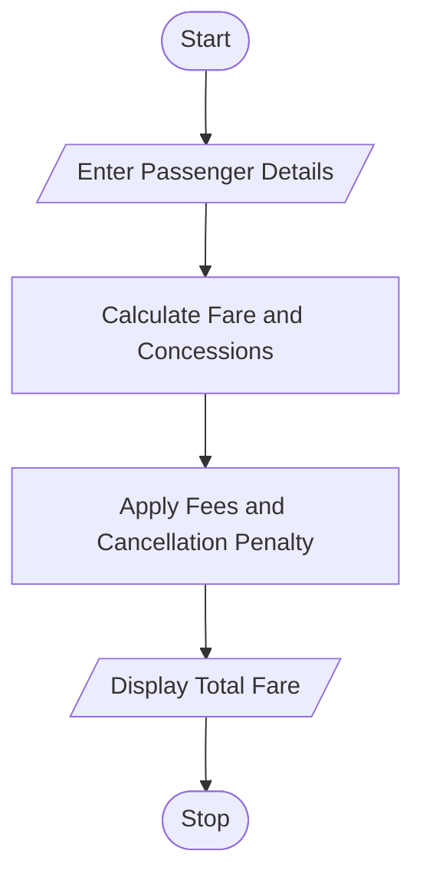

# 6. Railway Fare and Reservation Calculator Using Python

## 1. Problem Statement

Write a Python program to calculate railway fares for multiple passengers based on travel distance, travel class, age-based concessions, reservation fees, and cancellation penalties. The program should calculate the total fare and display the final payable amount.

## 2. Algorithm

1. Start.
2. Enter the number of passengers.
3. For each passenger, enter age, distance, travel class, and cancellation status.
4. Calculate the fare based on distance and class.
5. Apply the age-based concession.
6. Add the reservation fee.
7. Deduct the cancellation penalty for cancelled tickets.
8. Calculate and display the total payable amount.
9. Stop.

## 3. Flowchart 

## 5. Sample Input

Enter number of passengers: 2

Passenger 1
Enter age: 30
Enter distance in km: 200
Enter class (sleeper/ac): sleeper
Ticket cancelled? (yes/no): no

Passenger 2
Enter age: 65
Enter distance in km: 200
Enter class (sleeper/ac): ac
Ticket cancelled? (yes/no): yes

## 6. Sample Output

Passenger Fare: Rs. 350.0
Cancellation Penalty: Rs. 100
Passenger Fare: Rs. 430.0

Total Railway Fare: Rs. 780.0

Calculation:
- Passenger 1: \\(200 \times 1.50 + 50 = ₹350\\)
- Passenger 2: \\(200 \times 3.00 = ₹600\\); senior concession = ₹120; reservation = ₹50; cancellation penalty = ₹100. Refund = ₹550, so the cancellation charge retained is ₹100.

