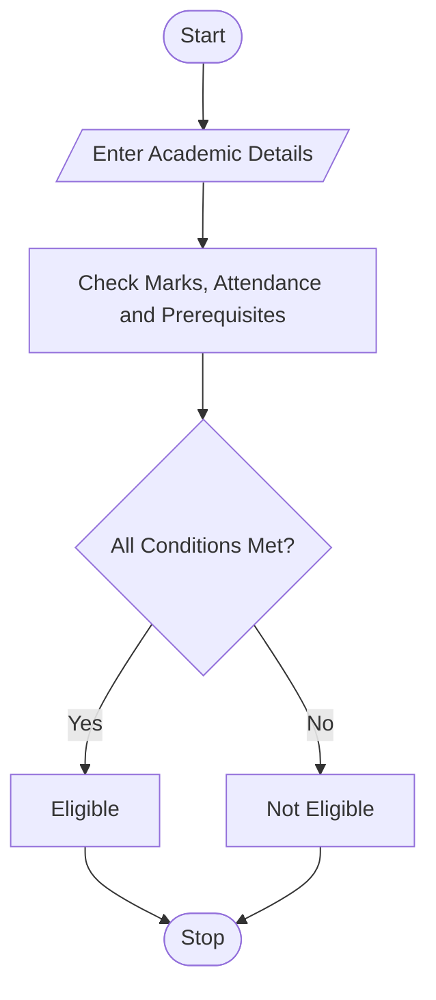

# 98. University Academic Progression Audit

## 1. Problem Statement

Write a Python program to evaluate a student's academic progress using semester marks, subject pass conditions, attendance percentage, and prerequisite completion. Determine whether the student is eligible for progression and display any outstanding requirements.

## 2. Algorithm

1. Start the program.
2. Enter the number of subjects and marks for each subject.
3. Check whether each subject meets the minimum passing mark.
4. Enter attendance percentage and prerequisite completion status.
5. Check whether attendance is at least 75%.
6. Verify that all prerequisites are completed.
7. Display progression eligibility and outstanding requirements.
8. Stop the program.

## 3. Flowchart 

## 5. Sample Input

Enter number of subjects: 3
Enter subject name: Mathematics
Enter marks: 75
Enter subject name: Python
Enter marks: 35
Enter subject name: English
Enter marks: 80
Enter attendance percentage: 70
Are all prerequisites completed? (yes/no): no

## 6. Sample Output

--- Academic Progression Report ---
Failed Subjects: Python
Outstanding Requirement: Attendance below 75%
Outstanding Requirement: Complete prerequisites
Progression Status: Not Eligible

