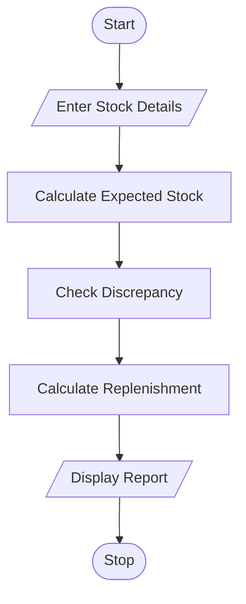

# 14. Warehouse Inventory Reconciliation

## 1. Problem Statement

Write a Python program to compare the opening stock, incoming quantities, dispatched quantities, and actual closing stock of multiple products. Detect stock discrepancies and calculate the additional quantity required for replenishment when stock falls below the minimum stock level.

## 2. Algorithm

1. Start the program.
2. Enter the number of products.
3. For each product, enter its name, opening stock, incoming quantity, dispatched quantity, actual closing stock, and minimum stock level.
4. Calculate expected closing stock using:
5. Compare expected closing stock with actual closing stock.
6. If both values differ, display the stock discrepancy.
7. If actual closing stock is below the minimum stock level, calculate the replenishment quantity.
8. Display the inventory report for all products.
9. Stop the program.

## 3. Flowchart

## 5. Sample Input

Enter number of products: 2

Product 1
Enter product name: Rice
Enter opening stock: 100
Enter incoming quantity: 50
Enter dispatched quantity: 80
Enter actual closing stock: 65
Enter minimum stock level: 40

Product 2
Enter product name: Sugar
Enter opening stock: 60
Enter incoming quantity: 20
Enter dispatched quantity: 50
Enter actual closing stock: 20
Enter minimum stock level: 40

## 6. Sample Output

--- Inventory Report ---
Product Name: Rice
Expected Closing Stock: 70
Actual Closing Stock: 65
Stock Discrepancy: -5
Replenishment Required: 0

--- Inventory Report ---
Product Name: Sugar
Expected Closing Stock: 30
Actual Closing Stock: 20
Stock Discrepancy: -10
Replenishment Required: 20

