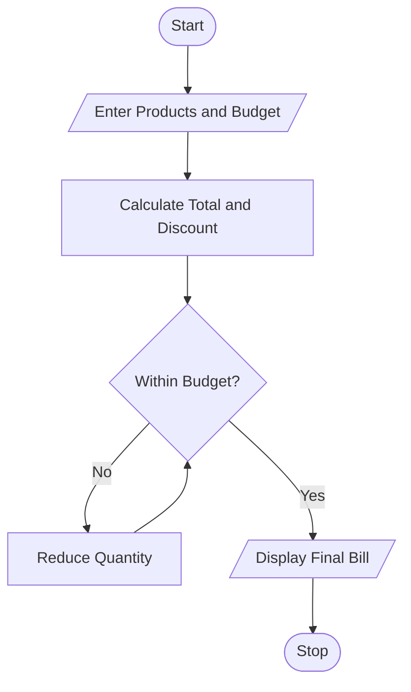

# 19. Multi-Product Shopping Budget Constraint

## 1. Problem Statement

Write a Python program to calculate the total cost of multiple products and quantities, apply a discount when the purchase amount reaches a specified limit, and reduce product quantities if the total cost exceeds the available budget.

## 2. Algorithm

1. Start the program.
2. Enter the shopping budget and number of products.
3. Enter each product name, price, and quantity.
4. Calculate the total shopping cost.
5. Apply a 10% discount if the total cost is ₹1,000 or more.
6. If the final cost exceeds the budget, reduce product quantities until the cost fits the budget.
7. Display the final quantities, discount, and total cost.
8. Stop the program.

## 3. Flowchart 

## 5. Sample Input

Enter your budget: 1000
Enter number of products: 3

Product 1
Enter product name: Shirt
Enter price: 400
Enter quantity: 2

Product 2
Enter product name: Shoes
Enter price: 600
Enter quantity: 1

Product 3
Enter product name: Cap
Enter price: 100
Enter quantity: 2

## 6. Sample Output

--- Final Shopping Bill ---
Shirt - Quantity: 1 Cost: Rs. 400.0
Shoes - Quantity: 0 Cost: Rs. 0.0
Cap - Quantity: 2 Cost: Rs. 200.0

Subtotal: Rs. 600.0
Discount: Rs. 0.0
Final Total: Rs. 600.0
Remaining Budget: Rs. 400.0

