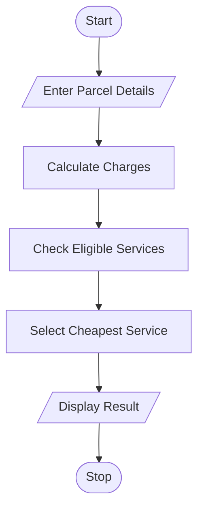

# 24. Courier Charge Optimization

## 1. Problem Statement

Write a Python program to calculate courier charges based on parcel weight, dimensions, distance zone, urgency, and restrictions. Compare available courier services and select the cheapest eligible service.

## 2. Algorithm

1. Start the program.
2. Enter parcel weight, length, width, height, distance zone, urgency, and restricted status.
3. Calculate the parcel's volume.
4. Check which courier services are eligible.
5. Calculate charges based on weight, zone, urgency, and parcel volume.
6. Compare the charges of eligible services.
7. Select and display the cheapest eligible service.
8. Stop the program.

## 3. Flowchart 

## 5. Sample Input

Enter parcel weight in kg: 5
Enter length in cm: 20
Enter width in cm: 15
Enter height in cm: 10
Enter distance zone (Local/National): Local
Enter urgency (Normal/Express): Normal
Is the parcel restricted? (yes/no): no

## 6. Sample Output

Eligible Courier Services:
Basic Courier - Rs. 220.0
Fast Courier - Rs. 430.0
Premium Courier - Rs. 520.0

Cheapest Service: Basic Courier
Total Courier Charge: Rs. 220.0

