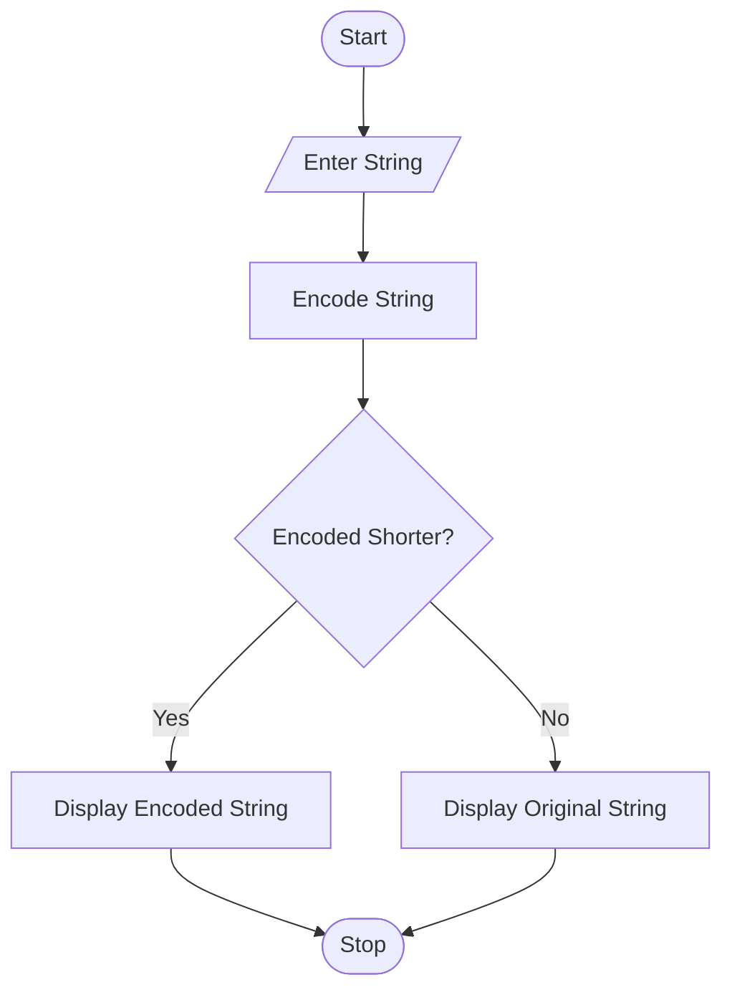

# 35. Text Compression Using Character Runs

## 1. Problem Statement

Write a Python program to compress a string by grouping consecutive repeated characters. Compare the original string length with the encoded string length and display the encoded string only when compression is beneficial.

## 2. Algorithm

1. Start the program.
2. Enter a string.
3. Count consecutive repeated characters.
4. Encode each group using the character followed by its count.
5. Compare the original and encoded lengths.
6. If the encoded string is shorter, display it; otherwise, display the original string.
7. Stop the program.

## 3. Flowchart 

## 5. Sample Input

Enter a string: aaabbcccccc

## 6. Sample Output

Original String: aaabbcccccc
Original Length: 11
Encoded String: a3b2c6
Encoded Length: 6
Compression is beneficial.

Original Length: 4
Encoded String: a1b1c1d1
Encoded Length: 8
Compression is not beneficial.
Final String: abcd

