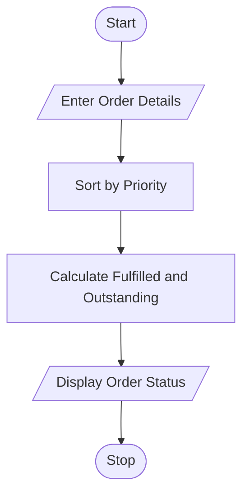

# 79. Integrated Warehouse Order Prioritization

## 1. Problem Statement

Write a Python program to process customer orders based on product demand, available stock, order quantity, and priority category. Determine whether each order can be fulfilled and calculate the outstanding quantity for incomplete orders.

## 2. Algorithm

1. Start the program.
2. Enter the number of orders.
3. Enter product name, available stock, order quantity, and priority.
4. Sort orders by priority: High, Medium, and Low.
5. Compare available stock with the order quantity.
6. Calculate fulfilled and outstanding quantities.
7. Update stock after fulfilling each order.
8. Display the order status and outstanding quantity.
9. Stop the program.

## 3. Flowchart 

## 5. Sample Input

Enter number of orders: 3

Order 1
Enter product name: Rice
Enter available stock: 50
Enter order quantity: 30
Enter priority (High/Medium/Low): Low

Order 2
Enter product name: Rice
Enter available stock: 50
Enter order quantity: 25
Enter priority (High/Medium/Low): High

Order 3
Enter product name: Sugar
Enter available stock: 20
Enter order quantity: 15
Enter priority (High/Medium/Low): Medium

## 6. Sample Output

Product: Rice
Priority: High
Fulfilled Quantity: 25
Outstanding Quantity: 0
Status: Fulfilled

Product: Sugar
Priority: Medium
Fulfilled Quantity: 15
Outstanding Quantity: 0
Status: Fulfilled

Product: Rice
Priority: Low
Fulfilled Quantity: 25
Outstanding Quantity: 5
Status: Partially Fulfilled

