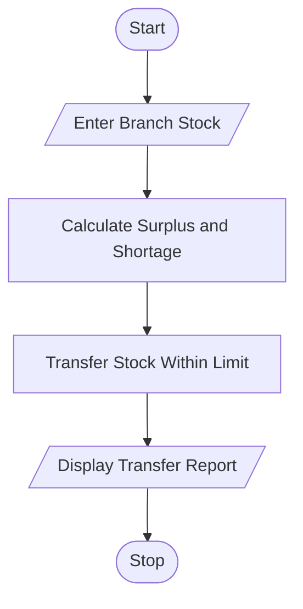

# 88. Multi-Branch Retail Inventory Transfer

## 1. Problem Statement

Write a Python program to compare stock available in different retail branches with their target stock levels. Calculate surpluses and shortages, and transfer products from surplus branches to shortage branches while respecting a maximum transfer quantity.

## 2. Algorithm

1. Start the program.
2. Enter the number of branches and products.
3. Enter each branch's current stock and target stock.
4. Calculate surplus and shortage for each branch.
5. Enter the maximum transfer quantity allowed.
6. Transfer stock from surplus branches to shortage branches.
7. Display the transfers and remaining shortages.
8. Stop the program.

## 3. Flowchart 

## 5. Sample Input

Enter number of branches: 3

Branch 1
Enter branch name: Branch A
Enter current stock: 100
Enter target stock: 60

Branch 2
Enter branch name: Branch B
Enter current stock: 30
Enter target stock: 70

Branch 3
Enter branch name: Branch C
Enter current stock: 50
Enter target stock: 50

Enter maximum transfer quantity: 25

## 6. Sample Output

--- Inventory Transfers ---
Branch A -> Branch B : 25 units
Branch A -> Branch B : 15 units

--- Final Inventory Status ---
Branch A
Remaining Surplus: 0
Remaining Shortage: 0
Branch B
Remaining Surplus: 0
Remaining Shortage: 0
Branch C
Remaining Surplus: 0
Remaining Shortage: 0

